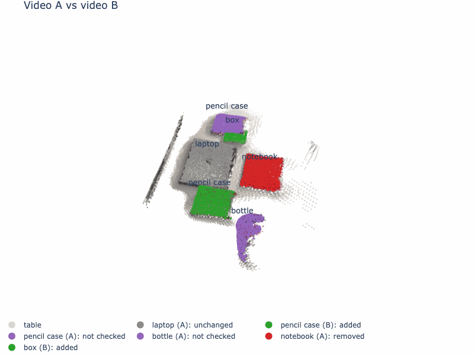

# Visibility-aware change detection

It only says something is gone if it looked.

Two phone videos of the same table go in. Out comes a 3D map of what was removed, added or moved, with one sentence per change. Anything the second video never looked at is marked "not checked", not "removed".



To turn it yourself, download [`results/AB/viewer.html`](results/AB/viewer.html) and open it in a browser. It works offline and on a phone.

## Why "not checked" matters

A robot that comes back to a room sees it from a new angle. A plain before and after comparison calls everything it can't see this time "removed", and the robot plans around a world that isn't real.

So before comparing, this system asks of every object whether the other video ever looked at its spot. Only if it did does it ask what was there. An object is removed only when the second video looked at its spot and found it empty.

## The test scene

| Video | What it shows |
|---|---|
| A, before | Laptop, notebook, pencil case, water bottle |
| B, after | Notebook gone, pencil case moved to the other side of the laptop, flashcards added. Filmed low and close, so the bottle is never in view |
| C, control | The same table as B, nothing changed, filmed from higher up |

A vs B is the test. B vs C has no real changes, so anything it reports is a false alarm. The ground truth was written at the table while filming, in [`data/ground_truth.yaml`](data/ground_truth.yaml).

The system wrote these sentences for A vs B ([`results/AB/changes.md`](results/AB/changes.md)).

> The notebook is gone. Video B saw 100% of that spot from 15 views, and 100% of what it saw was empty.
>
> A pencil case appeared. Video A saw 88% of that spot from 15 views, and 100% of what it saw was empty.
>
> A box appeared. Video A saw 100% of that spot from 15 views, and 100% of what it saw was empty.
>
> The pencil case was not checked. Video B saw only 41% of it, below the 50% needed to decide.
>
> The bottle was not checked. Video B saw only 0% of it, below the 50% needed to decide.
>
> The laptop is unchanged. Video B saw 100% of it from 15 views, and 100% of what it saw was the same object.

The "box" is the flashcards. That is the name the detector gave them.

## Results

The naive baseline is the same pipeline without the visibility test and without "not checked". The table is written by `python src/evaluate.py`.

<!-- results start -->
### Video A vs video B

| Object | Truth | Naive | Ours |
|---|---|---|---|
| notebook | removed | removed | removed |
| pencil case | moved | moved | **not checked + added** (wrong) |
| flashcards | added | added | added |
| water bottle | not checked | **removed** (wrong) | not checked |
| laptop | unchanged | unchanged | unchanged |

Naive gets 4 of 5 right and reports 4 changes. Ours gets 4 of 5 right and reports 3 changes.

### Video B vs video C

| Object | Truth | Naive | Ours |
|---|---|---|---|
| laptop | unchanged | unchanged | unchanged |
| pencil case | unchanged | unchanged | unchanged |
| flashcards | unchanged | unchanged | unchanged |
| water bottle | not checked | **added** (wrong) | not checked |

Naive gets 3 of 4 right and reports 1 change. Ours gets 4 of 4 right and reports 0 changes.

Video B vs video C has no real changes, so every change reported there is a false alarm.
<!-- results end -->

Both methods get 4 of 5 objects right on A vs B. The difference is the kind of mistake. The baseline calls the bottle removed, although video B never pointed at it. Ours misses the pencil case move. Video B saw only 41% of its old spot, below the 50% the system needs to decide, so it said "not checked" and had nothing to pair the new pencil case with. On B vs C the baseline reports one false change and ours none.

## How it works

1. **Frames.** The 15 sharpest frames from each video, one per equal slice of time.
2. **One 3D scene.** [VGGT](https://github.com/facebookresearch/vggt) reconstructs all 30 frames in one run, so both videos share one coordinate frame. The laptop's known width (30.41 cm) sets the scale. Its depth then comes out at 21.1 cm, against a real 21.5 cm.
3. **Objects.** [Grounding DINO](https://huggingface.co/IDEA-Research/grounding-dino-base) finds objects from a list of 15 everyday desk words. [SAM](https://huggingface.co/facebook/sam-vit-base) cuts each one out, and the depth lifts it into 3D. Detections that overlap in 3D become one object.
4. **Visibility test.** Each object's surface, in 1 cm cubes, is projected into every camera of the other video. A cube counts as seen if it lands inside the image and nothing stands in front of it. A seen cube is present if the other video has an object of about the same size there.
5. **Five states.** Under 50% seen is not checked. Present in at least half of what was seen is unchanged. Anything else is removed or added. A removed and an added object with the same label become moved.

Every threshold was checked on B vs C only. A vs B ran once, after they were frozen.

## Run it

**GPU part, in Colab (about 6 minutes per pair).** Open [`notebooks/gpu.ipynb`](https://colab.research.google.com/github/golovchits/visibility-aware-change-detection/blob/main/notebooks/gpu.ipynb) with a T4 runtime and run all cells. It downloads `AB.npz` and `BC.npz`. Put both in a `cache/` folder in your clone.

**Everything else, on any laptop with no GPU.**

```bash
conda create -n vacd python=3.11 -y
conda activate vacd
pip install -r requirements.txt

python run.py --pair AB     # writes results/AB/ in about a minute
python run.py --pair BC
python src/evaluate.py      # the results table
pytest                      # tests of the visibility test on a toy scene
```

Add `--gif` to `run.py` for the turning GIF. It takes about 4 minutes and needs Google Chrome installed.

Each `results/<pair>/` folder holds

| File | What is in it |
|---|---|
| `results.json` | Every object with its label, state, 3D centre in metres, how much of it the other video saw, and which frames saw it |
| `changes.md` | The sentences |
| `viewer.html` | The 3D view, one file |
| `viewer.gif` | The same view, turning |

Settings live in [`configs/default.yaml`](configs/default.yaml).

## Limits

- One table and five objects. A case study, not a benchmark.
- A move is found only when both spots were seen well enough. The pencil case shows the cost.
- Moves are paired by label. Two objects with the same label would confuse it.
- The detector's names are the names you get. The flashcards came out as "box".
- Sizes read about 2% short. The laptop's depth measured 21.1 cm against 21.5 cm.

## Design and prior work

The choices, what was rejected and what didn't work are in [`docs/DESIGN.md`](docs/DESIGN.md).

The idea is not new. Fehr et al. point out that comparing point clouds can't tell space nobody looked at from empty space, and use a volumetric map that can ([ICRA 2017](https://www.research-collection.ethz.ch/handle/20.500.11850/254898)). Ambruş et al. keep a model of a room across repeated robot visits and pick out what changed ([Meta-rooms, IROS 2014](https://strands.readthedocs.io/en/latest/datasets/meta_rooms.html)). This project brings the same question to two ordinary phone videos, with no depth sensor.
